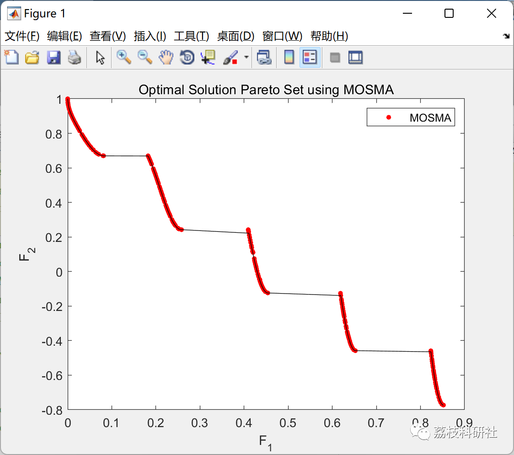

# Multi-Objective Mutual Optimization Algorithm (MOSMA) (Matlab Code Implementation)

💥💥💥💞💞💞💞 Welcome to this blog❤️❤️❤️💥💥💥
🏆 Bloggers' Advantage: 🌞🌞🌞 The content of the blog strives to be rigorous in thought and clear in logic, for the convenience of readers.
⛳️ Mantra: The journey of a hundred miles is half done in the last ninety.
🎁Column Directory:
🌈🌈🌈🌟🌟🌟Electrical Code Intelligent Algorithm and Its Application Path Planning Neural Network Predictive Optimization Scheduling Image Processing Workshop Scheduling Signal Processing Romantic Her Complete Code Matters
💥1 Overview
This article introduces a Multi-Objective Mud Mold Algorithm (MOSMA), a multi-objective variant of the recently developed Slime Mold Algorithm (SMA) designed for handling multi-objective optimization problems in industry. In recent times, several metaheuristic and evolutionary optimization techniques have been proposed to address optimization issues, aiming at identifying Pareto optimal solutions. However, these methods often suffer from low-quality solutions rather than accurately estimating the distribution of all objective functions and increasing the coverage of the best solution across all objectives. The SMA method follows the logic derived from the oscillating behavior of slime molds observed in laboratory experiments. Compared to other mature methods, the SMA algorithm demonstrates strong performance, and it is designed by combining a positive feedback system with the best food path. The proposed MOSMA algorithm employs the same underlying SMA mechanism for convergence and incorporates an elitism non-dominance sorting method to estimate the Pareto optimal solution. As a posterior method, the MOSMA maintains the multi-objective formulation and utilizes the crowding distance operator to ensure the coverage of the best solution across all objectives. To validate and confirm the performance of MOSMA, we considered 41 different case studies, including unconstrained, constrained, and real-world engineering design problems. We compared the performance of MOSMA against Multi-Objective Coexistence Biosearch (MOSOS), Decomposition-based Multi-Objective Evolutionary Algorithm (MOEA/D), and Multi-Objective Water Cycle Algorithm (MOWCA) in terms of various performance metrics such as generational distance (GD), inverse generational distance (IGD), maximum spread (MS), gap, and running time. Simulation results indicate that the algorithm achieves high-quality solutions for all multi-objective problems, encompassing linear, nonlinear, continuous, and discrete Pareto fronts. The effectiveness of the algorithm in solving complex multi-objective problems is demonstrated.
📚2 Run Results
🎉3 Matlab Code and Detailed Article Explanation
Click the article's lower left corner to read the full code or reply with keyword: Multi-Objective Mud Mold Algorithm
👨‍💻4 References
M. Premkumar, P. Jangir, R. Sowmya, H. H. Alhelou, A. A. Heidari and H. Chen, "MOSMA: Multi-objective Slime Mould Algorithm Based on Elitist Non-dominated Sorting," in IEEE Access, doi: 10.1109/ACCESS.2020.3047936.  

## Images

<!-- PAYMENT_BLOCK -->

## Get this dataset

- Payment link (Stripe): [Buy now](https://buy.stripe.com/3cs8yP7sY87d0vu9AB)
- Payment QR code: 

<!-- /PAYMENT_BLOCK -->
